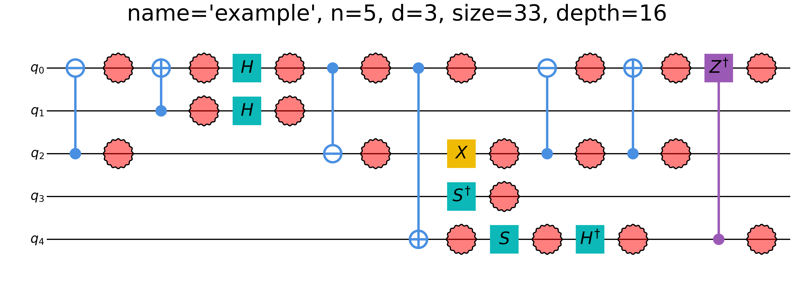

# quickqudits

**QuickQudits** is a Python framework for efficient classical simulation of noisy qudit Clifford circuits using stabilizer tableau formalism, with Monte Carlo sampling of Pauli/Weyl noise.

All dimensions are supported, with prime dimensions favoured.

Core Functionality:
- **Extended stabilizer tableaus** for qudits of arbitrary dimension `d`, storing X/Z exponents and a phase column, with Clifford updates over `Z_d`. 
- **Measurement / post-measurement updates** via a generalized Aaronson–Gottesman (CHP-style) procedure for **prime** dimensions.
- **Measurement** for **composite** dimensions via SNF.
- **Noise modeling** as probabilistic mixtures of Weyl operators.
- **Statevector / density-matrix backends** and circuit visualization utilities. 

## Installation

- Base:
```bash
pip install quickqudits
```

- With JIT speedups:
```bash
pip install "quickqudits[numba]"
```

- With plotting:
```bash
pip install "quickqudits[plot]"
```

- For dev/tests:
```bash
pip install "quickqudits[test]"
```

- Everything:
```bash
pip install "quickqudits[numba,plot,test]"
```

## Quick start

```python
import quickqudits as qq

# initialize circuit
n, d = 5, 3  # 5 qudits of dimension 3
qc = qq.QuantumCircuit(n, d, name="example")

# add gates
qc.CXdag(2, 0)
qc.CX(1, 0)
qc.H(0)
qc.H(1)
qc.CXdag(0, 2)
qc.CX(0, 4)
qc.X(2)
qc.S(4)
qc.Hdag(4)
qc.CXdag(2, 0)
qc.Sdag(3)
qc.CX(2, 0)
qc.CZdag(4, 0)

# add global depolarizing noise
qc.add_noise_global(0.5)

# visualize circuit
qc.draw(show_info=True)
```

### Generated circuit

The circuit produced by `qc.draw(show_info=True)`:



```python
# initialize tableau
tab = qq.Tableau(5, 3)

# draw samples from the noisy circuit
samples = tab.sample_measurements_noisy_pf(qc=qc, shots=5, seed=42)
print(samples, end="\n\n")

# execute the circuit and obtain tableau (ignoring noise channels)
tab.apply_circuit(qc)

# visualize tableau
print(tab)
```

### Output

```plaintext
[[2 0 0 0 1]
 [0 2 2 0 1]
 [2 2 1 1 1]
 [0 1 0 0 2]
 [0 1 1 0 0]]

#  | x0 x1 x2 x3 x4 | z0 z1 z2 z3 z4 | τ
────────────────────────────────────────
d0 |  0  0  0  0  0 |  1  0  0  0  0 | 0
d1 |  0  0  0  0  0 |  1  1  0  0  0 | 0
d2 |  0  0  1  0  0 |  2  0  0  0  0 | 0
d3 |  0  0  0  1  0 |  0  0  0  2  0 | 0
d4 |  0  0  0  0  1 |  2  0  0  0  2 | 4
----------------------------------------
s0 |  2  1  1  0  2 |  2  0  1  0  2 | 2
s1 |  0  2  0  0  0 |  0  0  0  0  0 | 0
s2 |  0  0  0  0  0 |  1  0  1  0  0 | 4
s3 |  0  0  0  0  0 |  0  0  0  1  0 | 0
s4 |  0  0  0  0  1 |  1  0  0  0  0 | 0
```